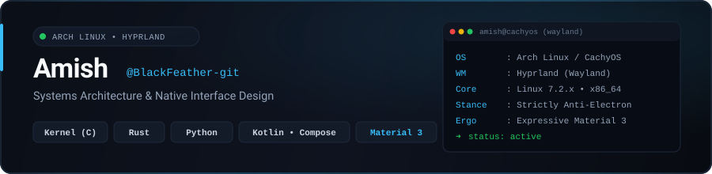

  
  
  
  

### Overview

I build kernel modules, reverse-engineer undocumented hardware, and write zero-overhead native tooling—with a graphic design background that makes the interfaces usable. My formal education combines a Bachelor of Computer Applications (Professional) with a Diploma in Advertising & Graphic Design.

- **Systems control:** Linux platform modules, ACPI/WMI drivers, embedded Qualcomm modem infrastructure, and low-level hardware protocols.
- **Anti-bloat architecture:** Strictly anti-Electron. Software should launch instantaneously, operate within deterministic memory ceilings, and respect hardware constraints.
- **Design-first ergonomics:** Applying formal graphic design foundations to build purposeful Material Design 3 interfaces with calibrated motion, spring physics, and deliberate typographic hierarchy.

---

### What I Actually Do

- **Write kernel drivers** in C and Rust for hardware that vendor background suites bloat or abandon.
- **Reverse-engineer embedded firmware** and bootchains to bring mainline Linux userspaces to locked-down hardware.
- **Build native utilities with bounded memory** in Rust, Kotlin, and Python—engineered spec-first with verified contract tests.

---

### Featured Systems

| Project | Summary & Architecture Trade-off | Constraint / Metric | Stack |
| :-- | :-- | :-- | :-- |
| **HP Omen HyperX Subsystem** | Custom Linux platform driver with ACPI power hooks, WMI call integration, sysfs controls, and a Rust CLI. *Chose a kernel platform driver over a userspace daemon to bind directly into ACPI sleep paths (`omen_rgb_resume`), restoring hardware lighting states on system wake.* | **800 MB suite → < 5 MB resident** | Linux Kernel C, DKMS, ACPI/WMI, Rust |
| [**JioFi 4 (JMR1140) Modem Revival**](https://github.com/BlackFeather-git/aether-link) | Reverse-engineered Qualcomm MDM9607 cellular modem platform. *Implemented `lk2nd` as a second-stage bootloader to chainload standard Linux kernels without modifying vendor primary partition tables.* | **Boots proprietary hardware into clean Linux userspace** | Qualcomm MDM9607, C, ARM, Embedded Linux, lk2nd |
| [**RAM-TUI**](https://github.com/BlackFeather-git/ram-tui) | Zero-overhead terminal memory monitor and process inspector built for lightweight Wayland/Hyprland workflows. Direct `/proc` parser avoiding high-level overhead. | **< 2 MB resident memory, zero external dependencies** | Rust, Linux procfs, TUI |

---

### Technical Depth & Tooling

| Layer | Technologies & Tooling | Where it shows up |
| :-- | :-- | :-- |
| **Kernel & Low-Level** | Linux Kernel Modules (C), DKMS, ACPI, WMI, Embedded Linux (ARM/Qualcomm), Rust | HP Omen platform driver, JioFi 4 modem kernel, RAM-TUI memory monitor |
| **Protocols & Hardware** | Linux HID, BlueZ / DBus, Wireshark, Serial/UART, Unix Domain Sockets | Peripheral lighting controllers, Qualcomm serial bring-up, IPC subsystems |
| **Native UI & Motion** | Kotlin, Jetpack Compose, Material Design 3 Architecture, Micro-interactions | Android native client prototypes, fluid spring-motion interaction layers |
| **Environment & Tooling** | Arch Linux, CachyOS, Hyprland (Wayland), Neovim, Git, Clang/LLVM | Daily development workstation, bespoke compositor configuration, build systems |

---

### Activity & Metrics

  
  

  

  Cards generated locally via <code>scripts/generate-stats.mjs</code> and updated daily via GitHub Actions.

