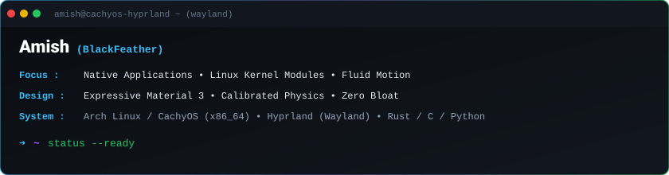
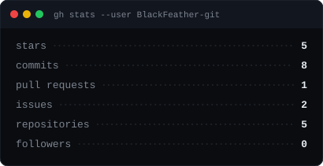
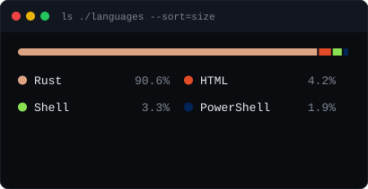
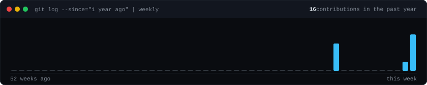

  
  
  
  

<table>
<tr>
<td width="60%" valign="top">

### About

I work at the boundary between **graphic-design ergonomics** and **low-level systems engineering**. My background pairs Advertising & Graphic Design with Computer Applications to build interfaces that feel deliberate and software that respects the machine it runs on.

Every project starts with a written contract — memory budgets, protocol decoders, interaction curves, and threat models — before a single line of code exists. I own code review, hardware testing, and hardening directly.

- **Operating rule:** Anti-Electron, anti-bloat. If it does not start instantly and operate under a strict memory ceiling, it does not ship.
- **Visual rule:** Material Design 3 with tokenized color, spring-based motion, and purposeful typography — never decorative fluff for its own sake.
- **Systems rule:** Reverse-engineer what is undocumented. ACPI, WMI, Linux HID, and vendor firmware are all fair game.

</td>
<td width="40%" valign="top">

### Dossier & Contact

| Channel | Address |
| :-- | :-- |
| Work | [amish.syam@gmail.com](mailto:amish.syam@gmail.com) |
| Urgent | [blackfeatheractual@proton.me](mailto:blackfeatheractual@proton.me) |

 

**Daily Driver:** Arch Linux / CachyOS · Hyprland (Wayland) · Neovim  
**Focus:** Kernel modules · embedded Linux · terminal tooling · Material 3

</td>
</tr>
</table>

---

## Featured Projects

| Project | Summary | Stack |
| :-- | :-- | :-- |
| **HP Omen HyperX Subsystem** | Linux kernel platform driver with ACPI power management hooks, WMI call integration, sysfs controls, and a high-performance Rust CLI layer. Replaces an 800 MB vendor background suite with a lean native module. | Linux Kernel C, DKMS, ACPI/WMI, Rust |
| **JioFi 4 (JMR1140) Revival** | Reverse-engineering Qualcomm MDM9607 modem architecture. Ports `lk2nd` secondary bootloader, patches the Linux kernel, and brings up Realtek Wi-Fi on proprietary mobile-router hardware. | Qualcomm MDM9607, C, ARM, Embedded Linux, lk2nd |
| [**RAM-TUI**](https://github.com/BlackFeather-git/ram-tui) | Zero-overhead terminal memory monitor and process inspector built for lightweight Wayland/Hyprland workflows. | Rust, Linux procfs, TUI |
| [**CareerPath India**](https://github.com/BlackFeather-git/careerpath) | AI-driven guidance platform providing regional and contextual career mapping. | Python, FastAPI, Machine Learning |

---

## Tech Stack

| Area | Tools & Technologies |
| :-- | :-- |
| Systems & Kernel | Linux Kernel Modules (C), DKMS, ACPI, WMI, Embedded Linux (ARM/Qualcomm), Rust |
| Hardware & Protocols | Linux HID, BlueZ / DBus, Wireshark, Serial/UART |
| Logic & Automation | Python, Bash, IPC Scripting, Systemd Services |
| Native UI & Motion | Kotlin, Jetpack Compose, Material Design 3 Architecture, Micro-interactions |
| Environment & Core | Arch Linux, CachyOS, Hyprland (Wayland), Neovim, Git |

---

## Activity & Metrics

  
  

  

Cards are generated by <code>scripts/generate-stats.mjs</code> and refreshed daily via GitHub Actions.
